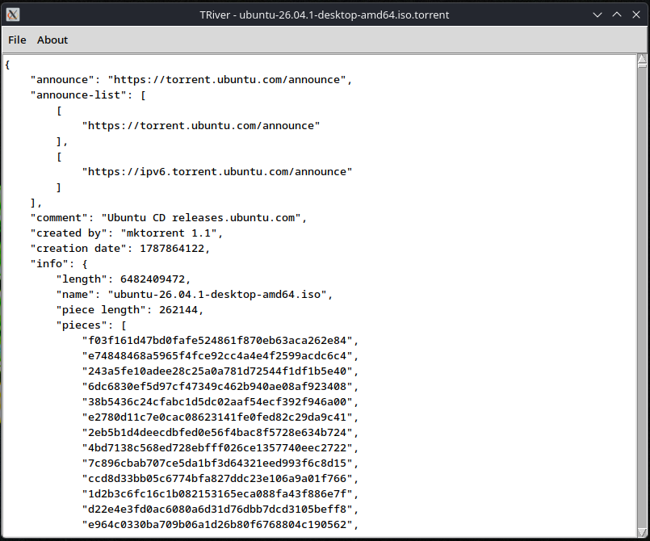

# TRiver (Torrent River)

### Description

**TRiver** (short for **Torrent River**) is a torrent metadata viewer and editor for Linux, Windows, and macOS.




### License
GPLv3 - [read here](https://github.com/Frankmau5/TRiver/blob/main/LICENSE)

### Install

#### For Linux Desktop

Download [Here](https://github.com/Frankmau5/TRiver/releases/download/v1.0.1/TRiver) the TRiver file and place it where you want, and add it to your `PATH`.


#### For Windows

Download [HERE](https://github.com/Frankmau5/TRiver/releases/download/v1.0.1/main.exe) the exe file and double click on it.


#### From Source (Linux, Windows, macOS)

Clone the project and go to the project folder.
Install the dependencies from `requirements.txt` with pip:

```bash
pip install -r requirements.txt
```

Then run `main.py` in a terminal:

```bash
python3 main.py
```

### Command-Line Options

You can pass command-line flags to choose the GUI backend or open a `.torrent` file on startup:

```bash
# Run with the default Tkinter GUI
python3 main.py

# Run with the modern Flet GUI
python3 main.py --flet

# Open a .torrent file on startup
python3 main.py -f path/to/file.torrent

# Open a .torrent file on startup using the Flet GUI
python3 main.py --flet -f path/to/file.torrent
```

| Option | Description |
| :--- | :--- |
| `--flet` | Launch TRiver using the Flet GUI instead of Tkinter |
| `-f FILE`, `--file FILE` | Open the specified `.torrent` file immediately on startup |
| `-h`, `--help` | Show help message and exit |

